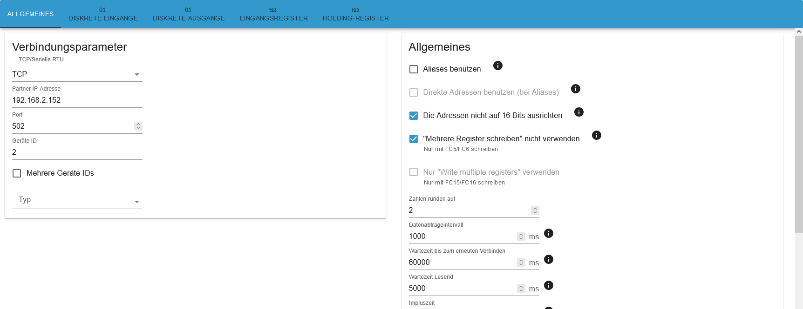

# Chint DTSU666

Modbus-RTU-Energiezähler Chint DTSU666.

## Einstellungen im Modbus-Adapter

Quelle: Issue [#52](https://github.com/ioBroker/modbus-templates/issues/52) von [TheBam1990](https://github.com/TheBam1990)
