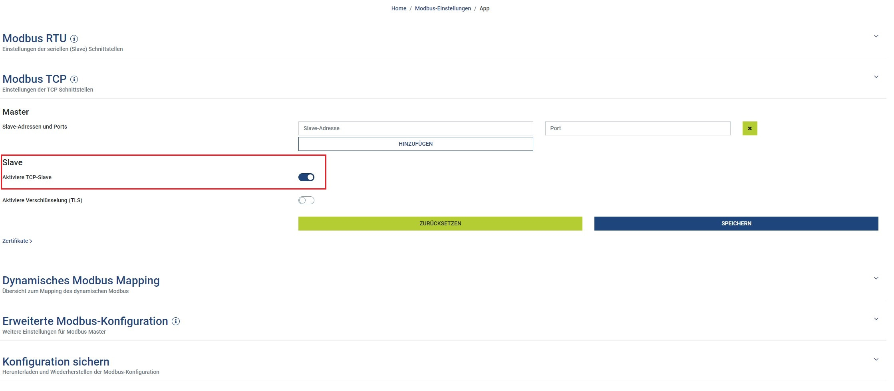
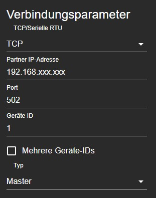
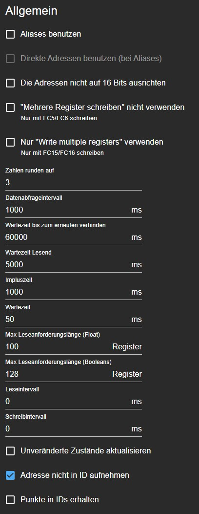

# Kostal Smart Energy Meter (KSEM)

Holding-Register für das Kostal Smart Energy Meter per Modbus TCP.

## Einstellungen im KSEM

Auf der Weboberfläche des KSEM muss Modbus TCP als **Slave** aktiviert werden, damit ioBroker als Master die Werte abfragen kann.

## Einstellungen im Modbus-Adapter

## Dokumentation

Offizielle Registerliste von Kostal: https://bit.ly/3kGAjHS

Quelle: Issue [#3](https://github.com/ioBroker/modbus-templates/issues/3) von [Schmattek](https://github.com/Schmattek)
