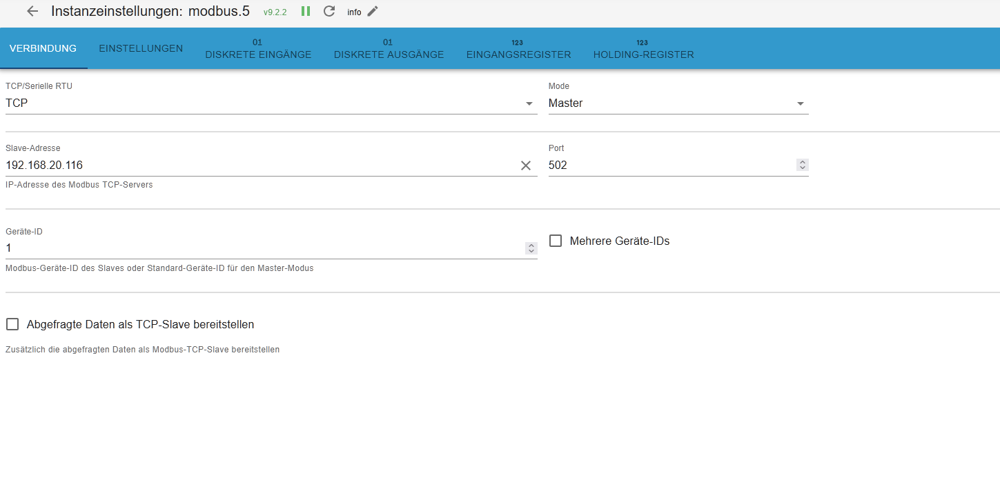

# Stiebel Eltron ISG / ISG plus

Input- und Holding-Register für Stiebel-Eltron-Wärmepumpen über das Internet Service Gateway (ISG web bzw. ISG plus) per Modbus TCP.

Quelle: Issue [#74](https://github.com/ioBroker/modbus-templates/issues/74) von [Schimi1983](https://github.com/Schimi1983)

## Einstellungen der Instanz

| Einstellung | Wert |
|---|---|
| TCP/Serielle RTU | TCP |
| Mode | Master |
| Slave-Adresse | IP-Adresse des ISG |
| Port | 502 |
| Geräte-ID | 1 |
| Aliases benutzen | **Ja** (Adressen 3xxxx / 4xxxx) |
| Direkte Adressen benutzen | Nein |
| Max Leseanforderungslänge | 40 Register |
| Register mit Lücken lesen | max. 10 Register Lücke |
| Datenabfrageintervall | 10000 ms |

Beim Import über die Vorlagenbibliothek des Adapters werden die Adressen automatisch an die Einstellung „Aliases benutzen“ der Instanz angepasst.

## Register

* `input-registers.tsv`: Temperaturen, Drücke, Volumenstrom, Betriebs- und Fehlerstatus, Wärmemengen, Leistungsaufnahme, Laufzeiten, SG-Ready-Betriebszustand, Reglerkennung (WPM 3 / WPM 3i / WPMsystem)
* `holding-registers.tsv`: Betriebsart, Komfort- und ECO-Temperaturen für Heizkreis 1 und Warmwasser, Heizkurve, Festwert- und Bivalenzbetrieb, Flächenkühlung, Reset, ISG-Neustart, SG Ready

> [!WARNING]
> `Reset` (41520): Der Wert **1 setzt die Wärmepumpe auf Werkseinstellungen zurück**. 2 löscht die Fehlerliste, 3 setzt die Wärmepumpe zurück. Das Register wird nicht gepollt.

## SG Ready

SG Ready wird über die Holding-Register 44001 bis 44003 gesteuert:

| Register | Bedeutung |
|---|---|
| 44001 `SG_Ready_Status` | SG Ready ein-/ausschalten |
| 44002 `SG_Ready_Eingang1` | Eingang 1 |
| 44003 `SG_Ready_Eingang2` | Eingang 2 |

Den aktuellen Zustand zeigt das Input-Register 35001 (1 = Sperre, 2 = Normal, 3 = forciert, 4 = Maximal).

Getestet mit dem **ISG plus**. Das einfache ISG hat laut Ersteller keinen SG-Ready-Eingang, dort geht SG Ready nur über Modbus.
