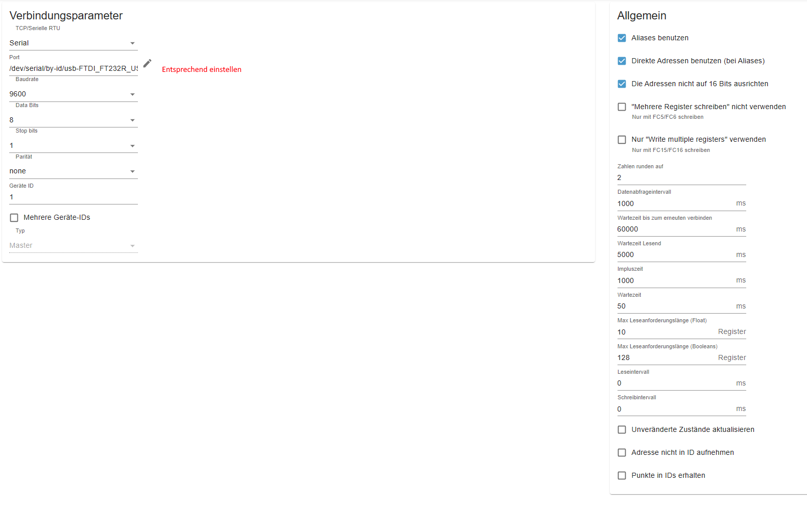

# Swentibold EuroAir250

Holding- und Input-Register für die Lüftungsanlage Swentibold EuroAir250.

## Hardware

Falls im Gerät noch keine Modbus-Platine verbaut ist, wird benötigt:
- EuroAir WTW-Controller RS485
- RS485-zu-USB-Konverter

## Einstellungen im Modbus-Adapter

Quelle: Issue [#8](https://github.com/ioBroker/modbus-templates/issues/8) von [Schimi1983](https://github.com/Schimi1983)
