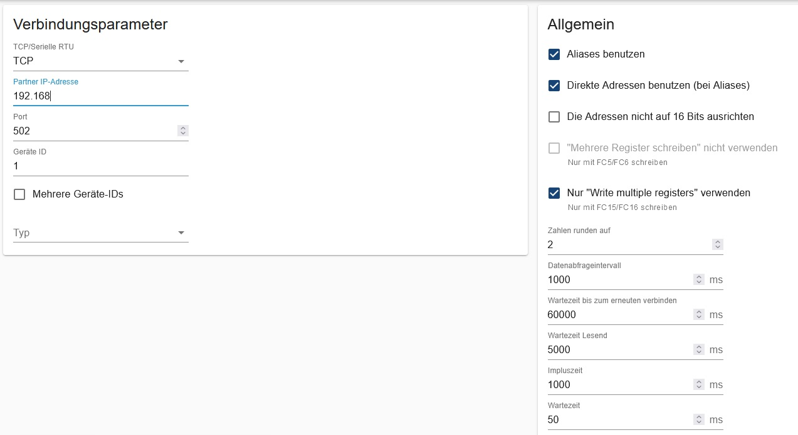

# Deye Hybrid Wechselrichter SUN-5~12K-SG04LP3-EU

---------------------------------------------------------

## Einstellungen im Modbus-Adapter:

## Erweiterte Registerliste

`holding-registers-extended.tsv` enthält zusätzliche Register und korrigierte Datentypen (u. a. vorzeichenbehaftete Werte für Batterie- und Netzleistung). Die meisten Register sind mit `poll = false` angelegt und müssen bei Bedarf aktiviert werden.

Quelle: Issue [#48](https://github.com/ioBroker/modbus-templates/issues/48) von [jugi80](https://github.com/jugi80)

---------------------------------------------------------

# Deye Hybrid Wechselrichter SUN-5~25K-SG01HP3-EU-AM2 (Hochvolt)

Template: [SG01HP03-holding-registers.tsv](SG01HP03-holding-registers.tsv) für die dreiphasigen Hochvolt-Hybrid-Wechselrichter SUN-5…25K-SG01HP3-EU-AM2 (laut Register-Basis auch SUN-29.9…50K-SG01HP3-EU). Getestet an einem SG01HP3 über Modbus TCP.

## Einstellungen im Modbus-Adapter

- „Use aliases“ aktiv (Adressen 4xxxx).
- „Max read request length“ **15**. Bei 20, 25 und 100 laufen die Blöcke 142–177 bzw. 672–683 in Timeouts und der Adapter verbindet sich neu; 10 funktioniert ebenfalls.
- „Reconnect delay“ 10 s statt 60 s, damit ein einzelner Timeout nicht eine Minute ohne Daten kostet.
- „Use only Write multiple registers“ (FC16) aktiv.

## Hinweise zur Registerliste

- **Nicht gepollt** (`poll = false`, bei Bedarf aktivieren): Systemzeit (40063–40065), BMS 2 (40242–40251), Batterie 2 (40590, 40594–40597) und Generator-Port (40662–40668). Diese Register brauchen optionale Hardware bzw. werden selten benötigt. Nach dem Aktivieren ändern sich die Lese-Blöcke – Adapter-Log auf Timeouts prüfen.
- Temperaturen (40541, 40542, 40587, 40597) sind mit +1000 (= 100 °C) Offset kodiert, daher `factor 0,1` und `offset -100`.
- 32-Bit-Zähler (Gesamtenergie) liegen Low-Word zuerst vor, daher Typ `uint32sw`.
- PV- und Batterieleistung haben Faktor 10.
- **Firmware:** Die TSV ist für **Firmware ≥ 1098** angelegt. Ab dieser Version zählen die Energiezähler (40515–40538: Batterie, Netz, PV, Last, Generator) in ganzen kWh, daher Faktor `1`. Bei älterer Firmware (< 1098) in den kWh-Zeilen Faktor `0,1` eintragen. Version prüfen: am Display unter „Device Info“ → „MAIN“, z. B. `Ver 3002-1098-1E08` = 1098.
- **Ein/Aus** (40081 = Register 80, schreibbar), laut Deye-Protokoll V104.3 (SG01HP3-AM2) und V105.1 „Switch on and off enable“: 0 = aus (Standby, Status 40501 = 0), 1 = ein. Entspricht dem Ein/Aus-Schalter am Display (in [ha-solarman](https://github.com/davidrapan/ha-solarman/blob/main/custom_components/solarman/inverter_definitions/deye_p3.yaml) als Geräteschalter umgesetzt).
  - **Kein Watchdog:** Der WR bleibt aus, bis wieder 1 geschrieben wird – auch wenn ioBroker ausfällt.
  - Beim Einschalten läuft der Selbsttest mit Netzzuschaltung (Selbsttestzeit Register 82, bis 360 s).
  - Ob die Verbraucher am LOAD-/Backup-Ausgang im ausgeschalteten Zustand versorgt bleiben, vor dem Einsatz prüfen.
  - Nicht für häufiges Schalten gedacht (Relais). Für eine vorübergehende Leistungsbegrenzung mit Rückfall ist der Remote Control Mode (siehe unten) besser geeignet.
  - Nicht verwenden: 40112 (Register 111) = 2 „no battery“ als Standby-Ersatz – ändert die Systemkonfiguration und löste am Gerät einen „Grid mode has changed“-Fehler aus, der manuell quittiert werden musste. Register 60 „Remote Lock“ (0 = ein, 2 = aus) ist nur im HP3-Protokoll genannt und ungetestet.
- **Warn- und Fehlermeldungen** (40554–40559 = Register 553–558, nur lesend) sind Bit-Felder:
  - Warnungen 40554/40555: z. B. Bit 1 = Lüfter, Bit 2 = Netzphase falsch, Bit 3 = Zähler-Kommunikation; 40555 Bit 14 = Batterie nicht erkannt, Bit 15 = Parallel-Kommunikation.
  - Fehler 40556–40559: Bit n von 40556 = Fehlercode F(n+1), 40557 = F(n+17), 40558 = F(n+33), 40559 = F(n+49). Beispiel: 40556 = 4096 (Bit 12) → **F13 „Working mode change“**; laut Deye eine Minute warten, dann prüfen.
  - Ein Quittieren per Modbus sieht das Protokoll nicht vor.
  - **Summer abschalten:** am SG01HP3 getestet über das Display-Menü („Beep“ aus). Danach erscheinen Alarme nur noch im Display und in 40554–40559. Alternativ laut Protokoll Register 228 (Bit 2–3 „beep“, Zwei-Bit-Steuerung 10 = aus, 11 = ein, 00 = unverändert; Wert 8 = nur Beep aus) – ungetestet und nicht in der TSV.
- **Schreibbar** (`wp true`, Rolle `level`) sind außerdem 40109–40178:
  - Einstellungen: max. Lade-/Entladestrom (40109/40110), max. Netzladestrom (40129), Netzladen (40131), Arbeitsmodus (40143: 0 = Selling first, 1 = Zero export to load, 2 = Zero export to CT), max. Einspeiseleistung (40144), Solar-Einspeisung (40146).
  - Time of Use: Wochentage/Ein-Aus (40147, Bit 7 = Mo … Bit 1 = So, Bit 0 = TOU ein), je 6 Slots Startzeit (HHMM), Leistung, Spannung, Ziel-SOC, Ladequelle (Bit-Flags 1 = Netz, 2 = Generator, 32 = Verkauf).
  - Schreiben auf eigene Gefahr; falsche Werte können Wechselrichter oder Batterie beeinträchtigen.
- **Remote Control Mode** (41101–41122 = Register 1100–1121, schreibbar), Quelle: offizielles Deye-Protokoll „MODBUS RTU 三相储能通信规约 V105.4“ (2024-08-14, gilt für Drei-Phasen-Nieder- und -Hochvolt) aus [ha-solarman PR #978](https://github.com/davidrapan/ha-solarman/pull/978):
  - 1100 Remote-Modus ein/aus, 1101 Watchdog (10–18000 s, 65535 = aus), 1104 Steuerungsart (0 = AC, 1 = Batterie, 2 = Netz), 1105 Batteriesteuerung (2 = Leistung, 3 = SOC, 4 = Spannung+Strom, 5 = Leistung+SOC), 1106–1115 Sollwerte, 1117–1121 Blindleistung.
  - Leistungssollwerte (1109, 1111–1115) sind in % der **Nennleistung** des Wechselrichters (Faktor `0,1`, Bereich −120 bis +120 %). Beispiel 12-kW-WR: 1109 = −25 % → 3 kW Laden.
  - **1100:** Am SG01HP3 bestätigt: 1 = Remote-Modus ein (Anzeige im Display), 0 = aus – wie im Protokoll. Deyes EMS-Dokument (0 = Modus betreten, 1 = verlassen) ist hier falsch. Was 2/3 von 1 unterscheidet, ist nicht dokumentiert.
  - Laut Deye nur über die **RS485-Schnittstelle** unterstützt, nicht über den Solarman-/WLAN-Logger.
  - **Watchdog 1101** (am Gerät getestet):
    - Erst 1101 schreiben und **warten, bis der Wert zurückgelesen wurde**, dann 1100 = 1. Kommen beide zu schnell hintereinander, ist der Remote-Modus aktiv, aber der Watchdog zählt nicht und der WR fällt nicht zurück.
    - 1101 zählt im Sekundentakt herunter (Modbus-Polling setzt ihn nicht zurück). Bei 0 verlässt der WR den Remote-Modus und setzt 1101 wieder auf 65535 (aus).
    - Für Dauersteuerung 1101 vor Ablauf nachschreiben (Heartbeat); fällt ioBroker aus, kehrt der WR nach der eingestellten Zeit in den Normalbetrieb zurück.
  - Nicht übernommen: 1102/1103/1116 (im Protokoll nicht belegt) und die abweichende Belegung aus dem PR-Entwurf.
- **Systemzeit** (40063–40065) liegt byteweise vor und wird per `formula` in Jahr/Monat/Tag/Stunde/Minute/Sekunde zerlegt (nur lesend, standardmäßig nicht gepollt).
