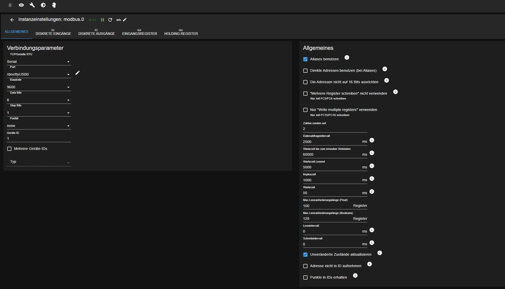

# Growatt SPH 8KTL3 BH-UP

Holding- und Input-Register für den Hybrid-Wechselrichter Growatt SPH 8KTL3 BH-UP (getestet mit Firmware 070612).

## Anschluss

RS485-3: A+ / B an Pin 1 und 5, GND an Pin 2.

## Einstellungen im Modbus-Adapter

Quelle: Issue [#51](https://github.com/ioBroker/modbus-templates/issues/51) von [TurboDud3](https://github.com/TurboDud3)
