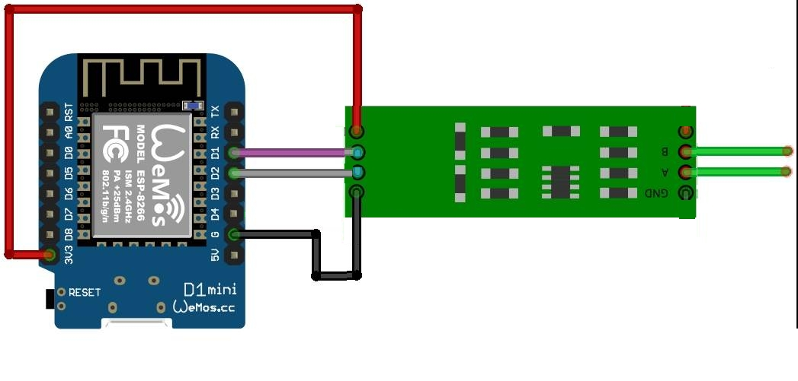
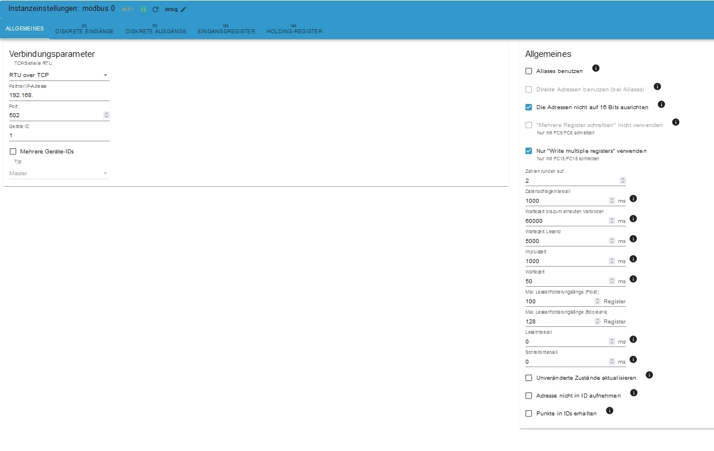
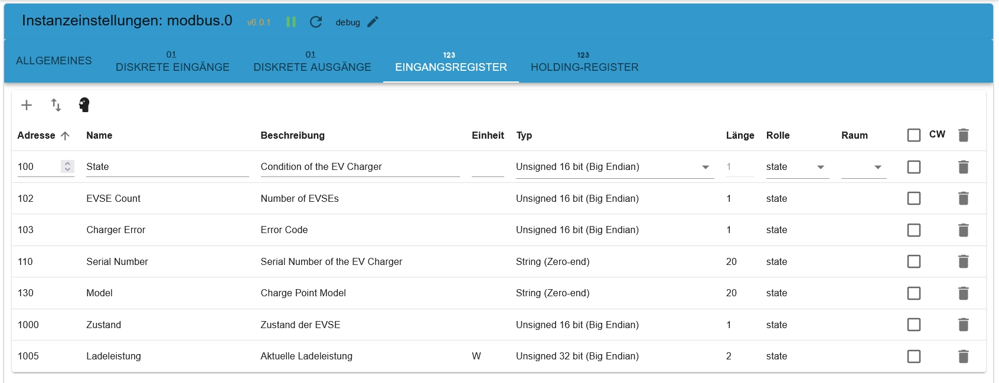
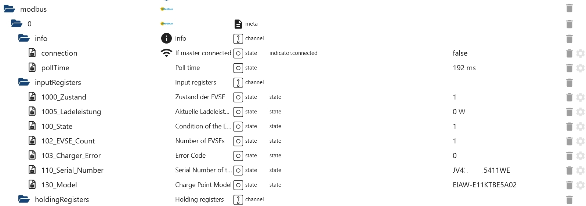

# Delta AC Max Wallbox

Register für die Wallbox Delta AC Max, angebunden per WLAN über einen ESP8266.

## Aufbau

- ESP8266 (Wemos D1 mini) mit ESPEasy, Device "Communication - Serial Server"
- TTL-auf-RS485-Modul, RX/TX an D1/D2 (die Hardware-RX/TX-Pins haben nicht funktioniert)
- ioBroker Modbus-Adapter im Modus "RTU over TCP"

## Einstellungen im Modbus-Adapter

## Ergebnis

Quelle: Issue [#20](https://github.com/ioBroker/modbus-templates/issues/20) von [heitec11](https://github.com/heitec11)
